<h1 align="center">Flutter + Spring Boilerplate</h1>

<p align="center">
  A production-ready Flutter starter for Android and iOS, wired end to end to a Spring Boot API:<br/>
  secure sign-in with rotating refresh tokens, role-based access control, the phone's own features,<br/>
  two languages, light and dark themes, 600+ tests and a CI/CD pipeline that ships signed builds.
</p>

<p align="center">
  
  
  
  
  
</p>

<p align="center">
  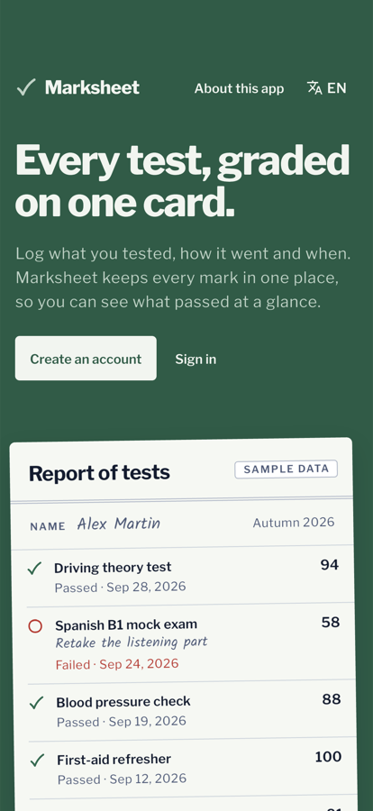
  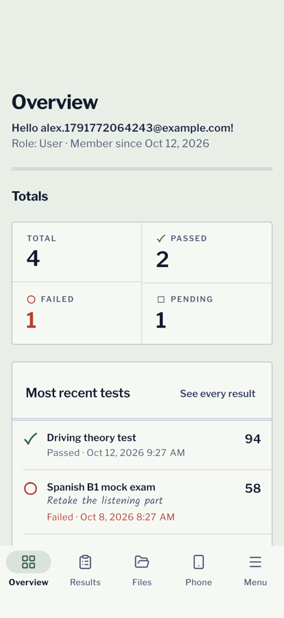
  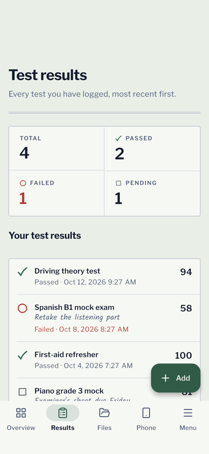
  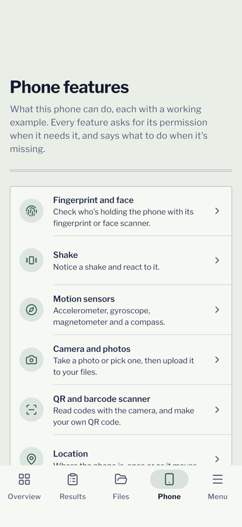
</p>

---

It is the phone counterpart of [nextjs-boilerplate](https://github.com/neszaDev/nextjs-boilerplate)
(web) and [spring-postgres-boilerplate](https://github.com/neszaDev/spring-postgres-boilerplate)
(API): the same sample product, **Marksheet** (a report card for test results), with the same
screens, texts and URLs, so a team can start a product on all three at once.

The sample product is there to show patterns, not to be kept: rename it, replace "test results"
with your own domain, and delete the demos you don't need ([how](docs/architecture.md#removing-the-demos)).

## Contents

- [What you get](#what-you-get)
- [Screenshots](#screenshots)
- [Quick start](#quick-start)
- [How it works](#how-it-works)
- [Commands](#commands)
- [Project layout](#project-layout)
- [Configuration](#configuration)
- [Testing](#testing)
- [CI/CD and releases](#cicd-and-releases)
- [Making it your app](#making-it-your-app)
- [Documentation](#documentation)
- [Contributing](#contributing) · [Licence](#licence)

## What you get

**Product screens, working against the real API**

- Welcome, about, sign-up and sign-in, with the backend's answers turned into clear messages
  (wrong password, email taken, "too many attempts, try again in 3 minutes", field errors).
- Overview, test results (add, edit, swipe to delete, totals, infinite scroll, pull to refresh),
  files (upload from documents, the camera or the photo library; open, share, delete), user
  management for admins (search, change role, delete), account and settings.
- Offline banner, loading skeletons, error cards with a retry button and the request id support
  needs to find the failure in the server logs.

**Security that holds up**

- Access and refresh tokens live only in the **Keychain / Android Keystore**
  (`flutter_secure_storage`), never in preferences, files or logs.
- **One refresh at a time**: the backend rotates refresh tokens, so parallel refreshes would sign
  users out; every request waits for the same in-flight refresh. A 401 is refreshed and retried
  once; only the backend can end a session, being offline never does.
- Release builds refuse plain http, Android backups are off, iOS tokens never sync to iCloud.
- Optional **app lock** with Face ID, fingerprint or the device passcode, and the app switcher
  shows a cover instead of your data.

**Role-based access control**

- One table maps roles (`USER`, `ADMIN`) to permissions. Routes, tabs, menu entries and buttons
  ask for a **permission**, never a role, so adding a role is a one-line change.
- Users without a permission see an "access denied" screen, not a crash or a sign-out; the
  backend's 403 is handled the same way, because the API stays the authority.

**The phone's own features**, each used by the app and shown in a working demo

| Feature | Used for |
|---|---|
| Face ID / Touch ID / fingerprint / passcode | App lock |
| Shake detection | A quick menu: shortcuts, problem report, debug info |
| Accelerometer, gyroscope, magnetometer, compass | Live readings |
| Camera and photo library, document picker | Uploading to Files |
| QR and barcode scanner, QR generator | Reading and sharing codes |
| Location | One-off and live position |
| Haptics | Feedback on success and errors (can be turned off) |
| Local notifications | Now, or scheduled even when the app is closed |
| Device, battery and network info | Offline banner, debug info |
| Share sheet, links, email, calls, clipboard | Opening and sharing files and links |

Every feature asks for its permission when it's first needed, explains a refusal and links to
the system settings when the refusal is permanent.

**A full component showcase**: all 51 demo pages of the web app ported to Flutter (buttons,
forms with validation and masks, rich-text and code editors, charts, tables with sorting and CSV
export, a drag-and-drop calendar, an email app, an invoice, maps, icons, typography and colours).

**Quality and team tooling**

- English and French from the web app's own message files, light and dark themes on one set of
  design tokens, accessible labels, 44 pt touch targets.
- 600+ unit and widget tests, an integration test against the real backend, and a check that the
  app's models still match the backend's OpenAPI spec.
- GitHub Actions with a single required check, signed Android builds, obfuscation symbols kept,
  Dependabot, a PR template and [`AGENTS.md`](AGENTS.md) for AI coding agents.

## Screenshots

| Overview (dark) | Menu | Settings | Charts | Calendar | Email |
|:-:|:-:|:-:|:-:|:-:|:-:|
| 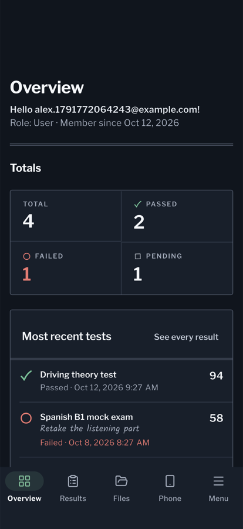 | 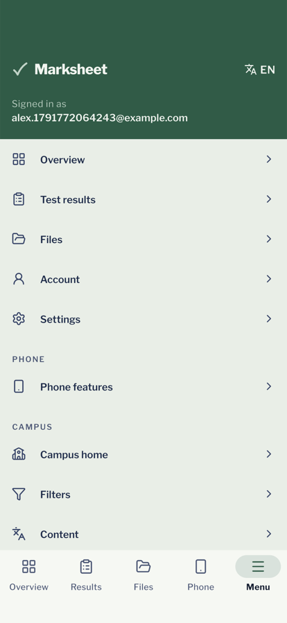 | 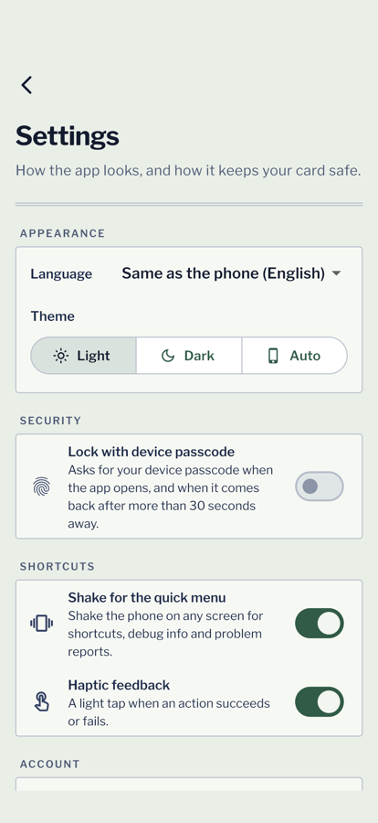 | 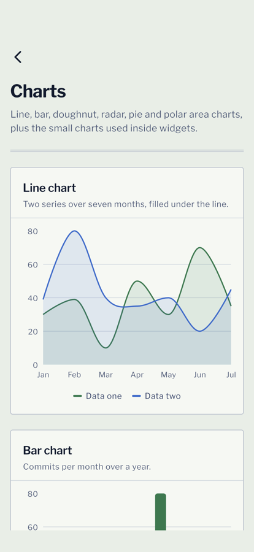 | 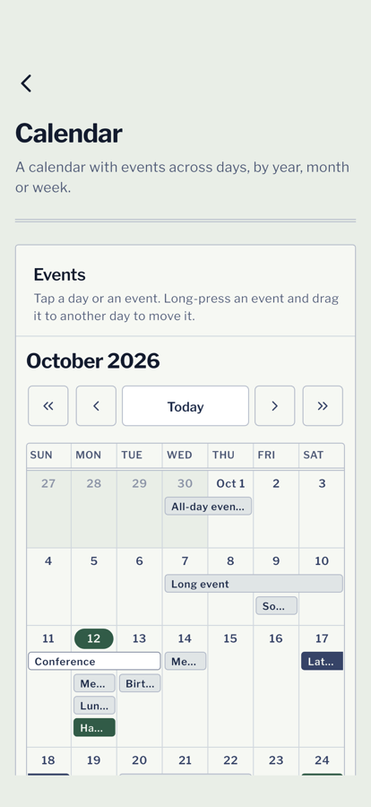 | 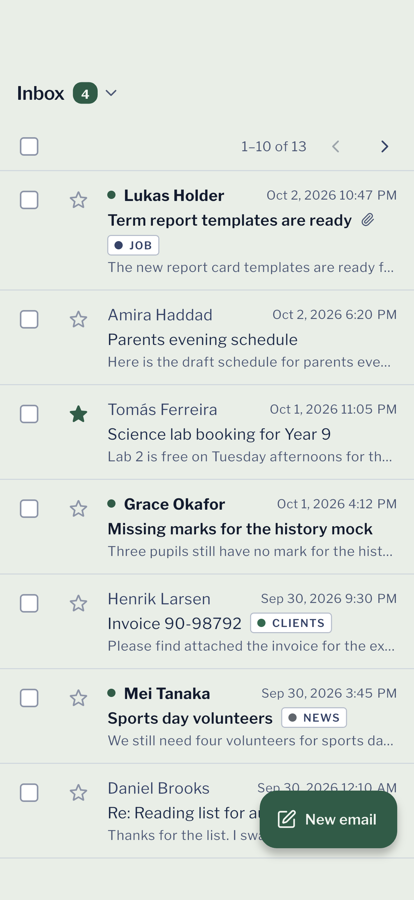 |

Regenerate them from the running app with `make screenshots`.

## Quick start

You need **Flutter 3.47** with Xcode (iOS) and/or the Android SDK (`flutter doctor` tells you
what's missing), **Docker** for the backend, and `make`.

```sh
git clone https://github.com/neszaDev/flutter-boilerplate.git
cd flutter-boilerplate

make setup        # dependencies, generated localizations, flutter doctor
make backend-up   # Postgres + the Spring API on http://localhost:8080 (Docker)
make run          # starts an iOS simulator or Android emulator if none is running
```

Create an account in the app, or sign in as the local admin `admin@e2e.test` /
`e2e-admin-password` to see user management.

- Port 8080 already taken? `make backend-up BACKEND_PORT=8090` and `make run BACKEND_PORT=8090`.
- A real phone on your Wi-Fi: put your computer's address in `env/dev.local.json`
  (copy `env/dev.local.json.example`).
- VS Code: the launch configurations in `.vscode/launch.json` do the same as `make run`.

## How it works

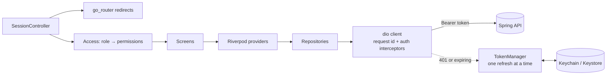

| Concern | Choice |
|---|---|
| State | Riverpod 3, no code generation |
| Navigation | go_router: auth redirects, five tabs with their own stacks, the web app's paths |
| HTTP | dio with interceptors for the token, the single refresh and request ids |
| Session | `flutter_secure_storage`; the last profile is cached so the app opens offline |
| Text | gen-l10n, built from namespaced ICU JSON shared with the web app |
| Design | Material 3 themed with the Marksheet tokens (`ThemeExtension`), bundled fonts |
| Errors | One `ErrorReporter` seam for uncaught errors; plug in the crash service you choose |

**Guarding a screen and a button** — permissions, not roles:

```dart
// lib/core/router/app_router.dart
guardedRoute(
  path: Routes.users,
  permission: Permission.viewUsers,
  builder: (_) => const UsersScreen(),
),

// any widget
PermissionGate(
  permission: Permission.deleteUsers,
  child: DeleteUserButton(user: user),
),
```

```dart
// lib/core/rbac/access_policy.dart: the only place that knows what each role may do
const rolePermissions = <Role, Set<Permission>>{
  Role.user: memberPermissions,
  Role.admin: {...memberPermissions, Permission.viewUsers, Permission.editUsers, Permission.deleteUsers},
};
```

**Calling the backend** — a repository per resource, failures arrive as `ApiException`:

```dart
Future<PageResult<TestResult>> list({required int page, required int size}) => apiCall(() async {
  final response = await _dio.get<Object?>(
    '/api/v1/test-results',
    queryParameters: {'page': page, 'size': size},
  );
  return PageResult.fromJson(asJson(response.data), TestResult.fromJson);
});
```

More in [architecture](docs/architecture.md), [RBAC](docs/rbac.md) and
[backend integration](docs/backend-integration.md).

## Commands

| Command | What it does |
|---|---|
| `make setup` | Dependencies, localizations, `flutter doctor` |
| `make run` | Run the app (`ENV=staging`, `DEVICE=<id>`, `EMULATOR=<id>`, `BACKEND_PORT=<port>`) |
| `make devices` | Connected devices and the simulators/emulators that can be started |
| `make fmt` | Format and apply automatic fixes |
| `make lint` | Format check, static analysis (infos fail too), localizations up to date |
| `make test` / `make coverage` | Unit and widget tests (with `coverage/lcov.info`) |
| `make verify` | Lint and tests, as CI runs them |
| `make l10n` | Rebuild localizations after editing `l10n/` |
| `make backend-up` / `backend-down` / `db-reset` | The local backend in Docker |
| `make e2e` | Integration test against the backend on a simulator/emulator |
| `make api-check` | Fail if the backend's API no longer matches the app's models |
| `make screenshots` | Regenerate `docs/screenshots` from the running app |
| `make build-apk` / `build-appbundle` / `build-ios` / `build-ipa` | Release builds (`ENV=prod`), obfuscated |

## Project layout

```
lib/
  main.dart, app.dart     startup: config check, logging, error handlers; MaterialApp
  core/                   shared by every feature
    api/                  dio clients, interceptors, ApiException, models
    auth/                 token store, single-flight refresh, session controller
    rbac/                 Role, Permission, the role → permission table, PermissionGate
    router/               paths, go_router setup, auth redirects, menu
    device/               biometrics, shake, haptics, notifications, connectivity
    theme/ l10n/ widgets/ settings/ config/ validation/ data/
  features/               auth, dashboard, test_results, files, users, account, settings,
                          menu, lock, shake, device (phone features), marketing, showcase
l10n/<locale>/*.json      every user-visible string
test/                     unit and widget tests, mirroring lib/
integration_test/         the end-to-end flow against the backend
env/                      dev / staging / prod build configurations
tool/                     l10n builder, API check, device helper, screenshot driver
docs/                     guides and decision records
android/ ios/ docker/ .github/
```

## Configuration

Build settings come from `env/<name>.json` via `--dart-define-from-file`; `make run ENV=staging`
picks `env/staging.json`, and a git-ignored `env/<name>.local.json` overrides it on your machine.

| Variable | Meaning |
|---|---|
| `APP_ENV` | `dev`, `staging` or `prod` |
| `BACKEND_URL` | The API's base URL. Empty in dev: the emulator/simulator reaches your computer automatically. **Release builds require https.** |
| `BACKEND_PORT` | Local backend port when `BACKEND_URL` is empty (default 8080) |
| `LOG_LEVEL` | `FINE` logs every request (never headers or bodies) |
| `SUPPORT_EMAIL` | Where "Report a problem" in the shake menu writes to |
| `MAP_TILE_URL` | Map tiles for the maps demo (OpenStreetMap by default, for development) |

Nothing in these files is secret: anything built into an app can be read back out of it.
See [configuration](docs/configuration.md).

## Testing

| Kind | Where | Run |
|---|---|---|
| Unit and widget | `test/` | `make test` |
| End to end, real backend | `integration_test/` | `make e2e` |
| API contract | `tool/api_check.dart` | `make api-check` |

Backend calls are faked at the transport, so the real interceptors (token, refresh, retry,
request id) run in every widget test. The refresh races, redirects, permission table and session
lifecycle all have their own tests. See [testing](docs/testing.md).

## CI/CD and releases

```
feature/* ──PR──▶ dev ──PR──▶ main ──tag v1.2.0──▶ GitHub Release (AAB + APK)
```

- **CI** on every pull request: lint, tests, an Android release build, an iOS build, the API check
  and the integration test on an Android emulator against the backend image. One **CI Gate**
  check is required to merge.
- **dev** builds staging releases for testers; **main** waits for approval and builds production
  releases, signed when the signing secrets are set; a `v*` tag publishes a GitHub Release.

See [CI/CD](docs/ci.md) and [releasing](docs/releasing.md) for signing, store uploads and reading
obfuscated crash traces.

## Making it your app

1. **Identity:** change the application id (`android/app/build.gradle.kts`) and bundle id (Xcode),
   the app name, icons and `AppConfig.name`.
2. **Backend:** point `env/staging.json` and `env/prod.json` at your API (public HTTPS).
3. **Domain:** replace "test results" with your resource: model, repository, screens, strings.
4. **Roles:** adjust `Role` and `rolePermissions` to your backend ([RBAC](docs/rbac.md)).
5. **Trim:** delete `lib/features/showcase/` and the phone features you don't use, along with
   their packages, native permissions and strings ([how](docs/architecture.md#removing-the-demos)).
6. **Decide:** crash reporting, push notifications, app/universal links
   ([open decisions](docs/plans/0001-flutter-setup.md#not-included-needs-a-decision)).

## Documentation

| Guide | Covers |
|---|---|
| [Architecture](docs/architecture.md) | Layers, session and refresh, routing, errors, removing the demos |
| [RBAC](docs/rbac.md) | Roles, permissions, guarding screens and controls, adding a role |
| [Configuration](docs/configuration.md) | Build configs, variables, backend reachability, app identity |
| [Backend integration](docs/backend-integration.md) | Clients, repositories, models, errors, adding an endpoint |
| [Localization](docs/localization.md) | Message files, ICU syntax, adding a language |
| [Phone features](docs/device-features.md) | Each feature, the app lock, native permissions, push notifications |
| [Testing](docs/testing.md) | Unit, widget and integration tests; manual release checks |
| [CI/CD](docs/ci.md) · [Releasing](docs/releasing.md) | Workflows, branches, signing, store uploads |
| [Decision record](docs/plans/0001-flutter-setup.md) · [Design](DESIGN.md) | Why it's built this way; the design system |

## Contributing

Branch from `dev`, open a pull request into `dev`, and use
[Conventional Commits](https://www.conventionalcommits.org/). `make verify` must pass (and
`make e2e` when auth, routing or a backend call changes). Details in
[CONTRIBUTING](.github/CONTRIBUTING.md); the rules for humans and AI agents are in
[AGENTS.md](AGENTS.md).

## Licence

[MIT](LICENSE). The sample product, its texts and design come from
[nextjs-boilerplate](https://github.com/neszaDev/nextjs-boilerplate), itself based on
[Next.js Boilerplate](https://github.com/ixartz/Next-js-Boilerplate) by ixartz (MIT).
Fonts: Libre Franklin and Kalam, SIL Open Font License ([`assets/fonts`](assets/fonts)).
