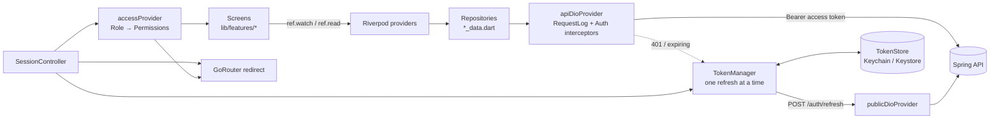

# Architecture

## Shape of the app

Unlike the web app, there is no server in between: the app calls the backend directly. What the
web app's Next.js server does (keep tokens away from page JavaScript, refresh them, guard routes)
is done here by the token store, the interceptors and the router.

| Layer | Where | Rule |
|---|---|---|
| Screens | `lib/features/<feature>/*_screen.dart` | Read providers, call controller/repository methods, render. No dio. |
| State | providers next to the feature (`*_data.dart`) | `FutureProvider` for reads, `PagedNotifier` for lists, `Notifier` for app state. |
| Data | repositories in `*_data.dart` | One class per backend resource; every call wrapped in `apiCall`. |
| Core | `lib/core/` | Shared by all features; never imports a feature (except the router, which assembles them). |

## Session design

| What | Where | Lifetime |
|---|---|---|
| Access token (JWT) + expiry | `TokenStore` (secure storage) and memory | token lifetime (15 min by default) |
| Refresh token + expiry | `TokenStore` | refresh-token lifetime (30 days by default), rotates on every use |
| Last profile (`/users/me`) | `TokenStore` | until sign-out |

- **Sign-in / sign-up** (`SessionController.signIn/signUp`) call `/auth/login` or
  `/auth/register`, store the tokens, then load `/users/me`. The profile's role drives every
  permission check.
- **Startup**: with stored tokens and a cached profile, the app opens immediately (offline too)
  and refreshes the profile in the background. Without a cached profile it waits for
  `/users/me` on the splash screen; if the backend can't be reached it says so and keeps the
  session (`RestoreFailed`), it never signs the user out for being offline.
- **Every request** goes through `AuthInterceptor`: it asks `TokenManager` for a valid access
  token (refreshing 30 s before expiry), and on a 401 refreshes once and retries once.
- **One refresh at a time.** The backend rotates refresh tokens, so two parallel refreshes with
  the same token would make the second fail and sign the user out. `TokenManager` shares a single
  in-flight refresh between all callers (tested in `test/core/auth/token_manager_test.dart`).
- **Only the backend ends a session**: a 400/401 from `/auth/refresh` clears the tokens and
  emits `onExpired`; the router goes to sign-in with "Your session ended". Network errors keep
  the session.
- **Sign-out** (`signOutToWelcome`) clears local tokens first, revokes the refresh token on the
  backend (best effort, like the web app), then shows the welcome screen. A session lost any
  other way (refresh refused, account deleted) lands on sign-in with "Your session ended".
- **App lock** (optional, Settings): a session restored at launch, or one coming back after more
  than 30 s in the background, sits behind the lock screen until Face ID / fingerprint / the
  device passcode succeeds. The app switcher shows the cover instead of the last screen.
- **Role changes**: an admin changing your role signs you out everywhere (backend). The app also
  re-reads `/users/me` when it comes back to the foreground and on pull-to-refresh of the
  overview.

## Routing

`lib/core/router/app_router.dart` (go_router):

- Public: `/` (welcome), `/about`, `/sign-in`, `/sign-up`; `/splash` while the session restores.
- Signed in: `/dashboard/**`, the web app's paths. Five tabs (`StatefulShellRoute`, each keeps
  its own stack): Overview, Results, Files, Phone, Menu. Everything else is pushed full screen
  over the tabs.
- `authRedirect` (pure, unit-tested) decides signed-in/out redirects and remembers where the user
  was going (`?from=`, app paths only).
- Per-route permissions: see [RBAC](rbac.md).

**Deep links.** Paths match the web app, so `https://<your web app>/dashboard/files` can open
the Files tab once you configure Android App Links (`assetlinks.json` + an intent filter) and iOS
Universal Links (`apple-app-site-association` + the Associated Domains entitlement). The router
already handles the paths; only the domain verification is product-specific.

## Where code goes

| Need | Put it in |
|---|---|
| A screen | `lib/features/<feature>/<name>_screen.dart`, route in `app_router.dart`, menu entry in `nav_items.dart` |
| Who may see it | a `Permission` in `access_policy.dart` + `guardedRoute(permission: …)` |
| Data from the backend | a repository + providers in `lib/features/<feature>/<feature>_data.dart`; models in `lib/core/api/models.dart` |
| Validation rules | `Rules` in the feature (`*_validation.dart`), mirroring the backend's request constraints |
| Text | `l10n/<locale>/<feature>.json`, then `make l10n` ([localization](localization.md)) |
| A build setting | `lib/core/config/env.dart` + `env/*.json` + [configuration](configuration.md) |
| A user preference | `lib/core/settings/settings_controller.dart` |
| A phone capability | a service in `lib/core/device/`, screens in `lib/features/device/` ([phone features](device-features.md)) |

## Error handling

- Backend failures arrive as `ApiException` with a `failure` kind (`network`, `unauthorized`,
  `forbidden`, `invalid`, `rateLimited`, …), the backend's `ApiError` body (message, field
  errors) and the `X-Request-Id` the backend logged. Screens show `errorMessage(context, error)`;
  `ErrorView` also shows the request id so a bug report can be matched with server logs.
- Field errors from the backend are shown under their inputs (`fieldErrors['email']`).
- Uncaught errors (`FlutterError.onError`, `PlatformDispatcher.onError`) and SEVERE log records
  go to the `ErrorReporter` passed to `bootstrap()`; the default writes them to the device log.
  Plug a crash-reporting service in there ([decision needed](plans/0001-flutter-setup.md)).
- Logs (`package:logging`) never contain tokens, passwords or request bodies.

## Removing the demos

The template ships three layers; keep the first, replace or delete the others:

1. **Core + product screens** (auth, overview, test results, files, users, account, settings).
   "Test results" is the example resource: rename it to your domain.
2. **Phone features** (`lib/features/device/`, `Permission.useDeviceFeatures`): keep what your
   product uses; remove the rest along with its plugin, its native permission entries
   (`AndroidManifest.xml`, `Info.plist`) and its strings.
3. **Showcase** (`lib/features/showcase/`, `Permission.viewShowcase`): delete the folder, its use
   in `app_router.dart`, its menu sections in `nav_items.dart`, `l10n/*/showcase_*.json`, and the
   packages only it uses (fl_chart, flutter_map, flutter_quill, highlight, flutter_spinkit, …).
